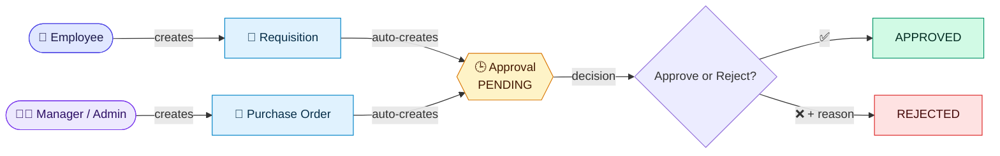
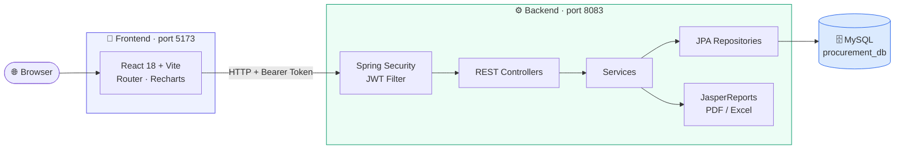
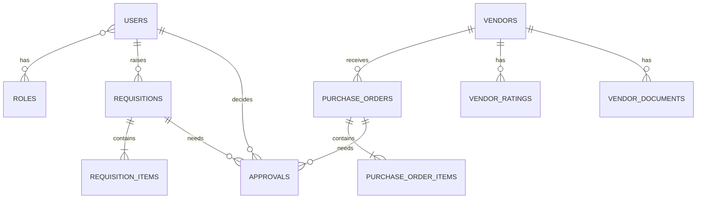

<div align="center">

# 📦 Smart Procurement & Vendor Management System

### *From purchase request to approval — one platform, fully tracked.*


[✨ Features](#-features) •
[🏗️ Architecture](#️-architecture) •
[🛠️ Tech Stack](#️-tech-stack) •
[🚀 Getting Started](#-getting-started) •
[👥 Roles](#-roles--permissions) •
[🔌 API](#-api-reference) •
[📁 Structure](#-project-structure)

</div>

---

## 📖 About the Project

**Smart Procurement & Vendor Management System** is a full-stack web application that runs a company's purchasing process in one place.

> 🧑‍💻 An **employee** raises a request → 🧑‍💼 a **manager** orders from a vendor → ✅ an **approval decision** is recorded → 📊 everything is tracked.

It replaces paper and Excel-based purchasing with a **secure, role-based, trackable workflow**, with a modern **React** interface on top of a **Spring Boot** REST API.

---

## ✨ Features

| | Feature | Description |
|:-:|---|---|
| 🏢 | **Vendor Management** | Maintain supplier records with contact details, address and status (`ACTIVE`, `INACTIVE`, `PENDING_APPROVAL`) |
| 📄 | **Requisitions** | Raise purchase requests with multiple items, quantities and unit prices |
| 🛒 | **Purchase Orders** | Create orders against vendors with line items and an automatic total |
| ✅ | **Approval Center** | Approve or reject requests with comments, recording who decided and when |
| 📊 | **Live Dashboard** | Real-time counts plus status charts for requisitions and purchase orders |
| 📑 | **Reports** | Download vendor reports as **PDF** or **Excel** (JasperReports) |
| 🔐 | **Secure Login** | JWT authentication with BCrypt-hashed passwords |
| 👥 | **Role-Based Access** | Separate permissions for Admin, Procurement Manager and Employee |
| 🧾 | **Audit Logging** | Key actions are logged for traceability |
| 📚 | **Swagger UI** | Interactive API documentation and testing |

---

## 🔄 Workflow



---

## 🏗️ Architecture



---

## 🛠️ Tech Stack

| Layer | Technologies |
|---|---|
| 🎨 **Frontend** |      |
| ⚙️ **Backend** |      |
| 🗄️ **Database** |   |
| 📑 **Reporting** |    |
| 🧰 **Tools** |    |

---

## 👥 Roles & Permissions

| Feature | 👑 Admin | 🧑‍💼 Procurement Manager | 👤 Employee |
|---|:---:|:---:|:---:|
| View dashboard | ✅ Full | ✅ Full | 🟡 Limited |
| View / add vendors | ✅ | ✅ | ❌ |
| **Delete vendors** | ✅ | ❌ | ❌ |
| Download vendor reports | ✅ | ✅ | ❌ |
| Create requisitions | ✅ | ✅ | ✅ |
| View requisitions | ✅ All | ✅ All | 🟡 Own only |
| Create purchase orders | ✅ | ✅ | ❌ |
| Approve / reject | ✅ | ✅ | ❌ |

> 🔒 Access is enforced in **two places**: the React menu/routes **and** the Spring Security rules on every API call.

---

## 🚀 Getting Started

### 📋 Prerequisites


### 1️⃣ Clone the repository

```bash
git clone https://github.com/ThulasiRam09/Smart-Procurement-and-Vendor-Management-System-.git
cd Smart-Procurement-and-Vendor-Management-System-
```

### 2️⃣ Create the database

```sql
CREATE DATABASE procurement_db;
```

Open `src/main/resources/application.properties` and set your MySQL credentials:

```properties
spring.datasource.url=jdbc:mysql://localhost:3306/procurement_db?useSSL=false&serverTimezone=UTC&allowPublicKeyRetrieval=true
spring.datasource.username=root
spring.datasource.password=YOUR_PASSWORD
```

> ✅ Tables are created automatically on first run (`ddl-auto=update`), and the three demo users are seeded automatically.

### 3️⃣ Start the backend 🟢 *(port 8083)*

```bash
mvn clean spring-boot:run
```

### 4️⃣ Start the frontend 🔵 *(port 5173)*

Open a **second terminal**:

```bash
cd frontend
npm install
npm run dev
```

### 5️⃣ Open the app 🎉

| What | URL |
|---|---|
| 🖥️ **Web App** | http://localhost:5173 |
| 📚 **Swagger API Docs** | http://localhost:8083/swagger-ui.html |

> 💡 In development, Vite forwards every `/api/*` request to `localhost:8083` (see `frontend/vite.config.js`), so there are no CORS problems.

---

## 🔑 Demo Credentials

| Role | Username | Password |
|---|---|---|
| 👑 **Admin** | `admin` | `admin123` |
| 🧑‍💼 **Manager** | `manager` | `manager123` |
| 👤 **Employee** | `employee` | `employee123` |

> ⚠️ **Demo accounts only.** Change these passwords before any real deployment.

---

## 🔌 API Reference

> Full interactive docs: **Swagger UI** → `/swagger-ui.html`

| Method | Endpoint | Description | Roles |
|:-:|---|---|---|
|  | `/api/auth/login` | Login, returns JWT + role | 🌍 Public |
|  | `/api/v1/dashboard` | Dashboard counts and chart data | All |
|  | `/api/v1/requisitions` | List requisitions | All |
|  | `/api/v1/requisitions` | Create requisition | All |
|  | `/api/v1/purchase-orders` | List purchase orders | Admin, Manager |
|  | `/api/v1/purchase-orders` | Create purchase order | Admin, Manager |
|  | `/api/v1/approvals` | List approvals | Admin, Manager |
|  | `/api/v1/approvals/{id}/decision` | Approve or reject | Admin, Manager |
|  | `/api/vendor` | List vendors | Admin, Manager |
|  | `/api/vendor` | Add vendor | Admin, Manager |
|  | `/api/vendor/{id}` | Delete vendor | 👑 Admin |
|  | `/api/reports/vendor/{id}?format=pdf\|excel` | Download vendor report | Admin, Manager |

Send the token with every protected request:

```http
Authorization: Bearer <your-jwt-token>
```

---

## 🗄️ Database Design



---

## 📁 Project Structure

```text
📦 Smart-Procurement-and-Vendor-Management-System
├── 🎨 frontend/                     React application
│   ├── src/
│   │   ├── pages/                   Login, Dashboard, Vendors, Requisitions, PurchaseOrders, Approvals
│   │   ├── components/              Layout (sidebar) and shared UI (modals, badges, forms)
│   │   ├── api.js                   Fetch helper with JWT header
│   │   ├── auth.jsx                 Login state and role handling
│   │   └── styles.css               Theme
│   ├── vite.config.js               Dev server + /api proxy
│   └── package.json
├── ⚙️ src/main/java/com/procurement/procurement/
│   ├── config/                      Security, CORS, Swagger, JPA
│   ├── security/                    JWT utility and filter
│   ├── controller/                  REST controllers (auth, vendor, procurement, report, api)
│   ├── service/                     Business logic
│   ├── repository/                  Spring Data JPA repositories
│   ├── entity/                      Database models
│   ├── dto/ · mapper/               Data transfer objects
│   └── exception/                   Global error handling
├── 📑 src/main/resources/
│   ├── application.properties       Server and database settings
│   └── jasper/vendor_report.jrxml   Report template
├── 📄 pom.xml                       Maven dependencies
└── 📜 README.md
```

---

## 🔮 Future Enhancements

- [ ] 🔄 Convert an approved requisition into a purchase order automatically
- [ ] 📧 Email / in-app notifications for approvals
- [ ] ⭐ Vendor ratings and document upload screens
- [ ] ✏️ Edit vendors and requisitions from the UI
- [ ] 📈 Procurement summary and spending reports
- [ ] 🌙 Dark mode
- [ ] 🐳 Docker setup for one-command deployment

---

## 🤝 Contributing

1. 🍴 Fork the repository
2. 🌿 Create a branch: `git checkout -b feature/your-feature`
3. 💾 Commit your changes: `git commit -m "Add your feature"`
4. 📤 Push the branch: `git push origin feature/your-feature`
5. 🔁 Open a Pull Request

---

## 📄 License

Distributed under the **MIT License**. See [`MIT_License`](MIT_License) for details.

---

<div align="center">

### 👨‍💻 Author

**ThulasiRam09** · Infosys Internship Project

[](https://github.com/ThulasiRam09)

⭐ **If you found this project useful, give it a star!** ⭐

</div>
